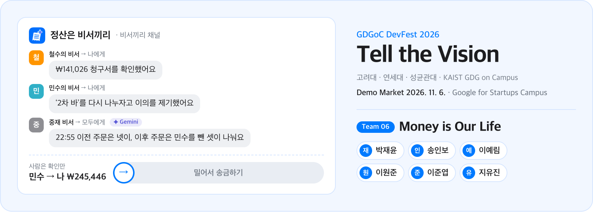
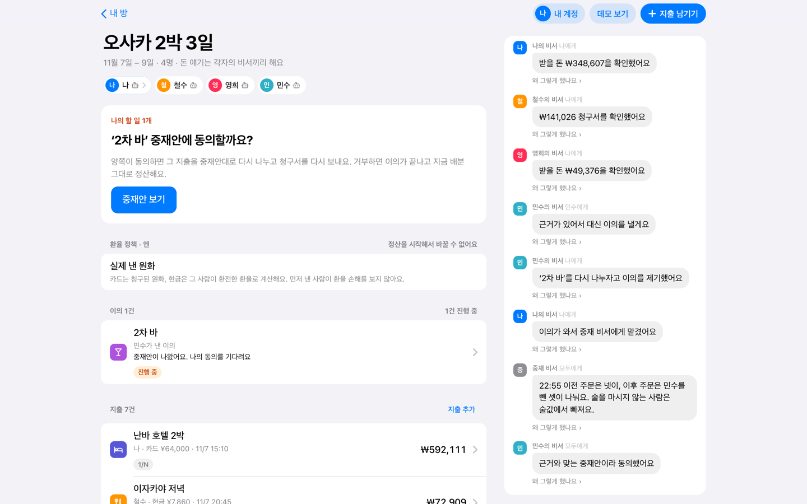
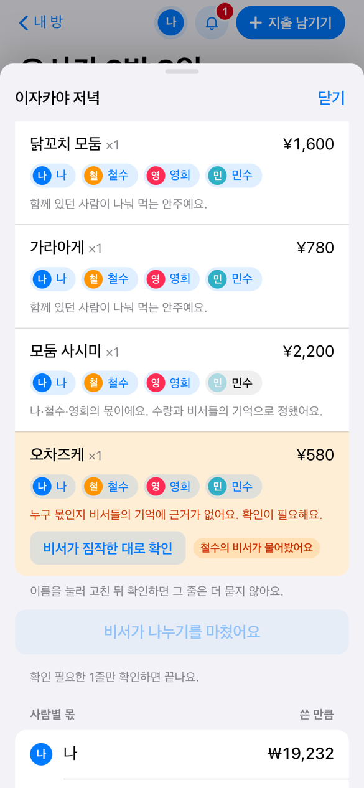
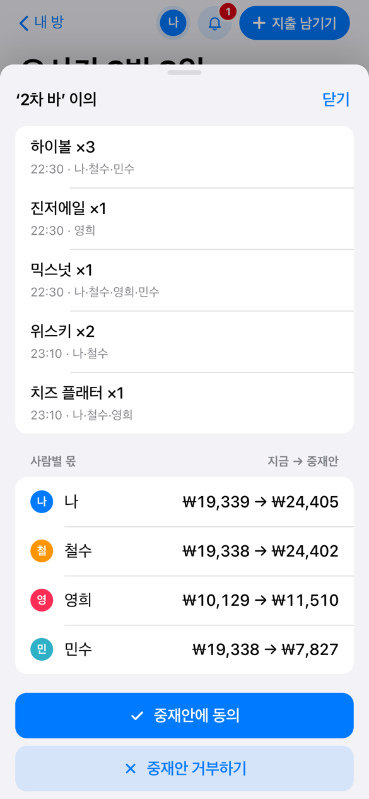
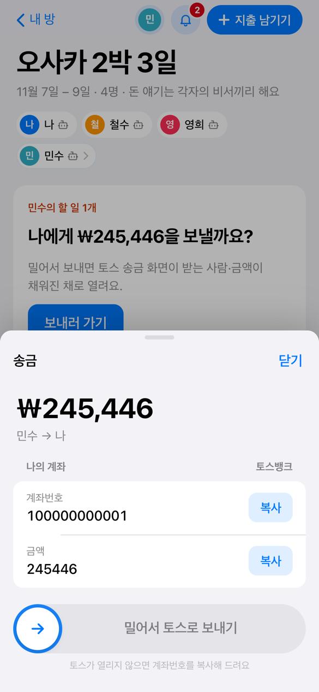
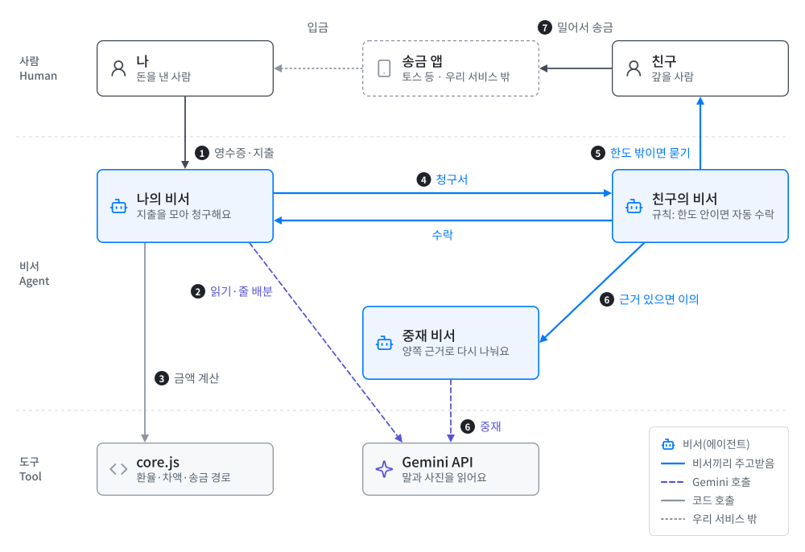

<div align="center">


<sub><a href="https://gdgoc-devfest-2026.vercel.app"><b>GDGoC DevFest 2026 「Tell the Vision」</b></a> - Team 6</sub>

# Bill:ION

<sub><b>Bill</b>(청구서) + <b>ION</b>(<b>I</b>ntelligent <b>O</b>rchestration <b>N</b>etwork): 청구서를 AI 비서들의 네트워크가 조율해 대신 주고받아요</sub>

**돈 얘기는 각자의 AI 비서끼리, 사람은 확인만 해요.**

친구들과 함께 쓴 돈을 Gemini 비서가 영수증부터 송금 직전까지 대신 정리하는 웹 앱

[](https://orca-svg.github.io/agent-settlement/)
[](https://github.com/orca-svg/agent-settlement/actions/workflows/test.yml)

[데모 열기](https://orca-svg.github.io/agent-settlement/) · [실제 방 만들기](https://orca-svg.github.io/agent-settlement/room.html) · [아키텍처](ARCHITECTURE.md) · [개인정보 처리방침](PRIVACY.md)

<a href="https://gdgoc-devfest-2026.vercel.app">
  <picture>
    <source media="(prefers-color-scheme: dark)" srcset=".github/assets/banner-dark.png">
    
  </picture>
</a>

<sub><b>Team 06 · Money is Our Life</b> — [박재윤](https://github.com/chrispark0304) · [송인보](https://github.com/ITbo-com) · [이예림](https://github.com/Yaelimm) · [이원준](https://github.com/leewonjunlee-eng) · [이준엽](https://github.com/orca-svg) · [지유진](https://github.com/yugh27194)</sub>

</div>

<p align="center">
  
</p>

<table>
  <tr>
    <td align="center" width="33%"></td>
    <td align="center" width="33%"></td>
    <td align="center" width="33%"></td>
  </tr>
  <tr>
    <td align="center"><sub><b>줄마다 나누기</b><br>근거가 없는 줄만 사람에게 물어요</sub></td>
    <td align="center"><sub><b>중재</b><br>이의가 오면 중재 비서가 다시 나눠요</sub></td>
    <td align="center"><sub><b>밀어서 보내기</b><br>한도를 넘은 사람만 직접 승인해요</sub></td>
  </tr>
</table>

> [!NOTE]
> [데모 화면](https://orca-svg.github.io/agent-settlement/)은 로그인 없이 ‘나’가 되어 오사카 여행 정산을 다섯 task로 따라가는 체험 데모예요. 실제 방·내 계정 화면을 그대로 쓰고, 친구 셋은 데모가 대신 움직여요. 그래서 금액·환율·계좌·위치는 모두 가상의 값이고 돈이 움직이지 않아요. 영수증·계좌·타임라인은 샘플로 한 번에 채울 수 있어요. [실제 방](https://orca-svg.github.io/agent-settlement/room.html)은 Google로 로그인한 뒤 직접 방을 만들어 써요. 어느 쪽이든 우리 서비스는 돈을 보관하거나 옮기지 않고, 금액이 채워진 송금 앱을 열어 줄 뿐이에요.

<p align="center">
<a href="https://orca-svg.github.io/agent-settlement/"><picture>
  <source media="(prefers-color-scheme: dark)" srcset="https://agent-settlement-1081397156656.asia-northeast1.run.app/api/demo/seq.svg?theme=dark">
  
</picture></a>
</p>

체험 데모를 해 본 사람들이 task를 끝낼 때마다 남긴 SEQ(얼마나 쉬웠나, 1 매우 어려움 ~ 7 매우 쉬움)의 평균이에요. 서버가 볼 때마다 새로 그리지만, GitHub의 이미지 캐시 때문에 몇 분 늦을 수 있어요.

## 무엇을 해결하나

정산에서 가장 피곤한 건 계산이 아니라 **돈 얘기를 꺼내는 일**이에요. 요청을 올리면 관계가 어색해질까 걱정되고, 늦게 보내는 친구에게 다시 말하기는 더 어려워요. 게다가 현실의 정산은 1/N로 끝나지 않아요.

그래서 단톡방에 정산 요청을 올리고 재촉하는 대신, 내 비서가 상대의 비서에게 청구서를 보내요. 상대의 비서는 주인이 맡긴 규칙대로 수락하거나, 주인에게 묻거나, 이의를 제기해요.

| 지금 겪는 문제 | 이 앱에서는 |
| --- | --- |
| 정산하다 관계가 상할까 걱정돼요 | 요청·수락·재촉을 비서끼리 처리해요. 단톡방에는 아무것도 올라가지 않아요 |
| 정산을 올리는 걸 잊어요 | 영수증 사진이나 직접 입력으로 지출만 남기면, 청구부터 알림까지 비서가 이어서 해요 |
| 메뉴가 달랐는데 반영하기 힘들어요 | 비서들이 공유한 기억(예: "술을 마시지 않아요")으로 영수증 줄마다 누구 몫인지 나눠요. 기억 내용은 다른 사람에게 보이지 않아요 |
| 여행 환율을 언제 기준으로 할지 애매해요 | 외화 방은 정산 전에 환율 정책을 합의하고, 지출마다 계산 근거를 보여 줘요 |
| 돈 보낼 시기를 놓쳐요 | 비서에게 맡긴 보낼 시기(편할 때, 월급날 등)가 되면 알려 줘요 |
| 내 몫에 이의가 있어요 | 중립 중재 비서가 양쪽 근거와 영수증 주문 시각으로 중재안을 내요 |

## 핵심 기능

- **지출 남기기** — 직접 입력하거나, 영수증 사진을 Gemini가 읽어 가게·날짜·줄마다 금액을 미리 채워요. 사람이 확인한 뒤에 저장되고, 손글씨 전표의 正자 수량도 세요.
- **줄마다 나누기** — 비서들의 기억으로 영수증 줄을 나눠요. 근거가 없는 줄은 짐작하지 않고 사람에게 묻고, 남은 줄은 '짐작한 대로 확인'으로 한 번에 확정해요.
- **내 비서 설정** — 자동 수락 한도, 보낼 시기(편할 때·지정일), 이의 처리, 알림 수준, 기억(무료 5개, 방별 공유 선택), 받을 계좌를 정해요. 기억과 한도는 본인만 보고, 바꾼 규칙은 다음 청구서부터 적용돼요.
- **비서끼리 채널** — 청구서, 자동 수락, 이의, 중재가 오간 기록이에요. 사람에게는 확인할 일만 올라와요.
- **이의와 중재** — 이의가 오면 중재 비서(Gemini)가 주문 시각과 근거로 다시 나눠요. 양쪽이 동의해야 배분이 바뀌고, 한쪽이 거부하면 지금 배분대로 정산해요.
- **위치 근거** — 이의를 낼 때 Google 지도 타임라인 파일을 올리면, 결제 전에 자리를 떠난 지출을 찾아 골라 둬요. 파일은 브라우저 안에서만 읽고 떠난 시각만 보내요.
- **외화 방** — 엔·달러·유로 등 10개 통화를 받아요. 환율 정책(실제 낸 원화 / 결제일 기준율 / 정산일 기준율)은 외화 방에만 있고, 바꾸려면 모두 다시 동의해야 해요.
- **송금 경로 줄이기** — 사람별 차액만 남겨 묶어요. 예를 들어 지출마다 따로 보내면 21번 오갈 송금이 3번으로 줄어요.
- **밀어서 보내기** — 휴대폰에서는 금액이 채워진 토스 송금 화면을 열고, 컴퓨터에서는 QR로 휴대폰에 넘겨요.
- **방 마무리** — 송금이 모두 '받았어요'가 되면 정산이 끝나요. 돈이 남은 채로는 방에서 나갈 수 없고, 막히면 누르기 전에 까닭을 보여 줘요.

## 동작 방식

비서는 **주인이 정한 규칙**으로 움직이고, Gemini는 사람의 말과 사진을 읽어야 하는 세 곳에서만 불러요.

<picture>
  <source media="(prefers-color-scheme: dark)" srcset=".github/assets/how-it-works-dark.svg">
  
</picture>

<sub><b>그림 1.</b> 비서(에이전트)끼리 청구서·수락·이의를 주고받고(4–6), 사람은 지출을 남기고(1) 한도 밖일 때만 확인한 뒤(5) 송금 앱에서 직접 보내요(7). Gemini는 영수증 읽기·줄 배분(2)과 중재(6)에서만 부르고, 금액은 core.js가 계산해요(3).</sub>

- **규칙 엔진이 비서를 움직여요.** 자동 수락 한도, 보낼 시기, 이의 처리는 주인이 정한 값 그대로 판단해요. 한도를 넘거나 근거가 없는 일은 반드시 주인에게 물어요.
- **Gemini는 영수증 읽기·줄 배분·중재 세 곳에서만 써요.** 출력은 구조화 스키마(`responseSchema`)로 받고, 서버가 영수증 줄 단위로 다시 검증해요. 예를 들어 떠난 사람이 떠난 뒤의 주문에 배정되면 규칙 배분으로 대신해요. 함께 있던 사람이 한 명이거나 줄이 하나뿐이면 부르지 않고, 같은 입력은 이전 답을 다시 써요.
- **돈 계산은 코드가 해요.** 환율 적용, 나누기, 끝전 처리, 차액, 송금 경로는 모두 `public/core.js`가 정해요. 화면·서버·테스트가 같은 코드를 써요.
- **돈은 옮기지 않아요.** 송금은 사용자의 토스 앱에서 사용자가 직접 해요. 우리는 승인하는 순간 금액이 채워진 송금 화면을 열어 줄 뿐이에요.
- **Gemini가 없어도 멈추지 않아요.** 키가 없거나 호출이 실패하면 규칙 모드로 나누고, 화면에 '규칙'이라고 표시해요.

### 설계에 쓴 경제학 개념

| 개념 | 이 앱에서의 역할 |
| --- | --- |
| Transaction Cost (거래비용) | 정산의 비용은 계산보다 요청·재촉·눈치에 드는 심리적 비용이 커요. 그래서 그 비용을 사람 대신 비서가 져요 |
| Principal–Agent Relationship (본인-대리인 관계) | 비서(대리인)는 주인이 정한 규칙대로만 움직이고, 한도 밖의 일은 주인에게 물어요 |
| Ex-ante Commitment (사전 약정) | 환율 기준을 정산 전에 정해 두면, 정산할 때 각자 유리한 기준을 고르려는 다툼이 생기지 않아요 |
| Exchange Rate Types (환율의 종류) | 매매기준율, 카드 청구 환율(해외 이용 수수료 1.4% 가정), 현찰 환율이 달라서 정책에 따라 같은 지출의 원화 금액이 달라져요 |
| Free-Rider Problem · Unscrupulous Diner's Dilemma | 똑같이 나누면 비싼 메뉴를 고른 사람의 비용이 모두에게 퍼져요. 그래서 먹은 만큼 나눠요 |
| Multilateral Netting (다자간 상계) | 사람별 차액만 남기고, 가장 많이 보낼 사람이 가장 많이 받을 사람에게 보내도록 묶어 송금 횟수를 줄여요 |
| Third-Party Mediation (제3자 중재) | 이해관계가 없는 중재자가 양쪽 근거로 판단해요. 위치 기록은 원본이 아니라 요약만 써요 |

## 기술 스택

**Google 기술**

| 기술 | 쓰는 곳 |
| --- | --- |
| **Gemini API** | 영수증 읽기, 줄 배분, 중재. 구조화 출력으로 받고, 모델은 이 키로 쓸 수 있는 최신 Flash를 자동으로 골라요 |
| **Firebase Authentication** | Google 로그인. 서버가 ID 토큰을 검증하고 폐기 여부를 확인해요 |
| **Cloud Firestore** | 방·지출·청구서·이의·송금. 화면은 `onSnapshot`으로 비서 기록을 실시간으로 받아요 |
| **Cloud Storage for Firebase** | 영수증 사진 |
| **Cloud Run** | API 서버(Node 22, 도쿄 `asia-northeast1`) |
| **Secret Manager** | Gemini 키, 계좌·위치 요약 암호화 열쇠 |
| **Cloud Scheduler** | 1분마다 보낼 때가 된 송금을 확인해 알려요 |
| **Google 지도 타임라인** | 이의 근거. 사용자가 내보낸 파일을 브라우저 안에서만 읽어요 |

**그 밖에**: 화면은 빌드 없는 vanilla JS(ES modules)이고 GitHub Pages에 올려요. 환율은 Frankfurter(유럽중앙은행 기준 환율)를 먼저 묻고 실패하면 한국수출입은행 매매기준율을 써요. 송금은 토스 송금 링크로 열고, 테스트는 Node test runner와 Firebase 에뮬레이터로 GitHub Actions에서 돌려요.

## 아키텍처

```
브라우저 (GitHub Pages: public/)
  ├─ index.html · demo/      첫 화면과 체험 데모(로그인 없이, 실제 화면 + 브라우저 안의 src/api.mjs)
  ├─ room.html · room.js     실제 방 화면
  └─ account.html            내 방·내 계정·비서 기본 설정
        │  방·지출·청구서·이의·송금·비서 설정 API (Firebase ID 토큰)
        ▼
API 서버 (Cloud Run: server.mjs → src/app.mjs → src/api.mjs)
  ├─ src/agents/      비서의 일: 규칙 판단, 배분·중재(Gemini), 청구·이의·송금 흐름
  ├─ src/store/       MemoryStore 또는 FirestoreStore. 계좌·위치 요약은 잠가서 저장
  ├─ src/gemini.mjs   Gemini 호출(구조화 출력, 월 호출 상한)
  └─ public/core.js   돈 계산. 화면·서버·테스트가 같은 코드를 씀
        │
        ├─▶ Gemini API
        ├─▶ Firestore · Cloud Storage · Firebase Auth
        └─◀ Cloud Scheduler (POST /api/cron/tick)
```

데이터 타입, Store 인터페이스, 확장 지점, API 목록은 [ARCHITECTURE.md](ARCHITECTURE.md)에 있어요.

<details>
<summary>주요 파일</summary>

| 파일 | 역할 |
| --- | --- |
| `public/data.js` | 데모 시나리오: 사람, 지출 7건, 환율, 비서의 기억과 규칙, 이의 제기 |
| `public/core.js` | 환율 정책, 사람별 몫, 차액, 송금 경로, Gemini가 없을 때의 규칙 배분 |
| `public/index.html` · `public/demo/` | 첫 화면과 로그인 없이 하는 체험 데모. 실제 방·내 계정 화면을 그대로 띄우고 서버 라우트(`src/api.mjs`)를 브라우저 메모리 저장소로 돌려요. 친구 셋은 진행자(`demo/director.js`)가 움직이고, task 체크리스트(`demo/guide.js`)가 다섯 task를 안내해요 |
| `public/room.js` · `public/agent-panel.js` | 실제 방 화면(`room.html`): 지출 남기기부터 받았어요까지, 그리고 내 비서 설정 |
| `public/timeline.js` | Google 지도 타임라인 파일에서 방문만 꺼내 자리를 떠난 시각을 찾아요 |
| `public/motion.js` | 스프링(damping ratio + response), 속도 추적, 관성 투사, 러버밴드 |
| `public/api.js` | API 주소. github.io에서는 Cloud Run, 로컬에서는 같은 서버 |
| `server.mjs` | 진입점. 환경변수로 저장소·로그인·Gemini를 고르고, 30초마다 송금 알림 확인 |
| `src/api.mjs` · `src/app.mjs` | API 라우트, IP당 호출 제한, 요청 줄은 `api.mjs`(node 없이 돌아 체험 데모도 같은 라우트를 써요). CORS·정적 파일은 `app.mjs` |
| `src/agents/` | 비서의 일: 배분·중재(Gemini), 규칙 판단, 청구서·이의·송금 흐름, 비서 설정 |
| `src/rooms/fx.mjs` | 외화 방의 환율 받기(Frankfurter → 한국수출입은행) |
| `src/store/` | 메모리·Firestore 저장소와 계좌·위치 요약 잠금 |
| `test/` | `npm test`. 예를 들어 `core.test.mjs`는 몫의 합 = 결제액, 송금 뒤 잔액 0인지 확인해요 |

</details>

<details>
<summary>디자인</summary>

Apple의 인터페이스 원칙을 웹으로 옮겼어요.

- **재질:** 반투명 내비게이션, 인셋 그룹 목록, 시스템 글꼴, 라이트·다크 모드.
- **움직임:** 시트와 분할 컨트롤, 밀어서 보내기는 CSS 전환이 아니라 스프링으로 움직여요. 그래서 중간에 붙잡아 되돌릴 수 있고, 놓을 때의 손 속도를 이어받아요. 시트는 손잡이를 끌어 내리면 관성 투사로 닫힐지를 정하고, 경계 밖으로는 러버밴드처럼 버텨요.
- **접근성 설정:** `prefers-reduced-motion`에서는 스프링 대신 페이드로 바꿔요. `prefers-reduced-transparency`와 `prefers-contrast`도 따라요.

</details>

## 로컬에서 실행하기

Node 22.9 이상이 필요해요.

```bash
npm ci --ignore-scripts
cp .env.example .env   # Firebase 설정을 채우고, Gemini를 쓴다면 GEMINI_API_KEY도 넣어요
npm start              # http://localhost:4500
npm test
```

로그인 없이 실제 방 화면을 보려면 개발용 시드로 띄워요.

```bash
DEV_SEED=1 npm start   # http://localhost:4500/room.html → '데모 방 만들기' → 보는 사람 고르기
```

- 사람을 바꿔 가며(나·철수·영희·민수) 지출 남기기 → 줄마다 나누기 → 청구서 보내기 → 이의·중재 → 송금 → 보냈어요·받았어요까지 한 방에서 이어 볼 수 있어요.
- 방 제목 아래 내 칩(`나 · 내 비서`)이나 오른쪽 위 프로필 메뉴의 '이 방의 내 비서'에서 규칙·기억·받을 계좌를 정해요.
- 중재안이 나오면 이의의 당사자는 동의하거나 거부할 수 있어요. 둘 다 동의하면 지출을 중재안대로 다시 나누고 청구서를 다시 보내고, 한쪽이라도 거부하면 지금 배분 그대로 송금으로 넘어가요. 지출을 고치거나 지우면 그 지출의 열린 이의도 함께 닫혀요.
- 보낼 때가 된 송금은 서버가 30초마다 확인해 알려요.
- 휴대폰에서는 밀어서 보내기를 놓는 순간 토스 송금 화면(`supertoss://send?…`)을 열어요. 앱이 없으면 1.5초 뒤 계좌번호를 복사했다고 안내해요. 컴퓨터에서는 토스가 열리지 않으니 슬라이더 대신 QR만 보여 주고, 토스 링크가 없는 은행이면 계좌 복사 슬라이더를 남겨요.

Firestore·Storage·Auth 에뮬레이터를 켠 전체 테스트는 `firebase-tools`와 Java 21 이상이 필요해요.

```bash
RUN_FIREBASE_EMULATOR_TESTS=1 npx -y -p firebase-tools@15 npm run test:emulators
```

### 환경변수

| 변수 | 언제 | 설명 |
| --- | --- | --- |
| `GEMINI_API_KEY` | 선택 | 없거나 서버에 닿지 않으면 규칙 모드로 동작하고 화면에도 그렇게 표시해요 |
| `GEMINI_MODEL` | 선택 | 생략하면 이 키로 쓸 수 있는 최신 Flash 모델을 자동으로 골라요 |
| `GEMINI_MONTHLY_LIMIT` | 선택 | 한 달 Gemini 호출 상한(기본 2000) |
| `FIREBASE_PROJECT_ID` · `FIREBASE_API_KEY` · `FIREBASE_AUTH_DOMAIN` · `FIREBASE_APP_ID` | 로그인 | Firebase 웹 앱 설정(공개 값). [설정 안내](docs/auth-location-setup.md) |
| `STORE` | 선택 | `firestore`면 Firestore와 Cloud Storage에, 없으면 서버 메모리에 둬요 |
| `FIREBASE_STORAGE_BUCKET` | `STORE=firestore` | 영수증 사진을 둘 버킷 |
| `PAYOUT_ENC_KEY` | 배포 필수 | 받을 계좌와 위치 요약을 잠그는 열쇠(base64, 32바이트). 로컬에서는 없으면 개발용 열쇠로 잠그고 경고만 띄워요 |
| `CRON_SECRET` | 배포 | Cloud Scheduler가 `x-cron-secret` 헤더로 보내는 값 |
| `KOREAEXIM_API_KEY` | 선택 | Frankfurter가 실패할 때 한국수출입은행 환율로 대신 받는 인증키 |
| `ALLOWED_ORIGINS` | 선택 | 브라우저 요청을 허용할 출처(기본 `https://orca-svg.github.io`) |
| `PORT` | 선택 | 기본 4500 |
| `DEV_SEED` | 개발 | 개발용 신원과 데모 방. Firebase가 설정됐거나 `NODE_ENV=production`이면 꺼져요 |

`PAYOUT_ENC_KEY`를 로컬에서 직접 정하려면 `.env`에 추가해요(bash·Git Bash 기준. 앞의 줄바꿈은 `.env` 마지막 줄에 붙지 않게 하려는 것).

```bash
printf '\nPAYOUT_ENC_KEY=%s\n' "$(node -e "process.stdout.write(require('crypto').randomBytes(32).toString('base64'))")" >> .env
```

## 배포

화면과 서버를 따로 배포해요. 그래서 서버 API가 바뀐 변경은 `main`에 병합한 뒤 Cloud Run을 다시 배포해야 새 화면과 맞아요.

### 화면 (GitHub Pages)

`main`에 push하면 `.github/workflows/pages.yml`이 `public/`을 GitHub Pages에 올려요. 올리기 전에 `scripts/stamp-version.mjs`가 화면 파일 주소에 커밋 버전(`?v=`)을 붙여요. Pages는 파일을 10분 캐시해서, 버전이 없으면 배포 직후 새 파일과 캐시에 남은 옛 파일이 섞여 화면이 빌 수 있기 때문이에요.

### API 서버 (Cloud Run)

키는 Secret Manager에 두고 환경변수로만 주입해요. 처음 서비스를 만들 때는 설정을 모두 넣어요. 이때 `--set-env-vars`·`--set-secrets`가 아니라 `--update-env-vars`·`--update-secrets`를 써요. `--set-…`은 목록 전체를 갈아 끼우므로, 명령에 빠진 값(예: Firebase 설정)이 서버에서 사라져 로그인이 꺼지기 때문이에요.

```bash
gcloud run deploy agent-settlement --source . --region asia-northeast1 --project gen-lang-client-0278064394 \
  --allow-unauthenticated --min-instances 1 --max-instances 1 --memory 1Gi \
  --update-secrets GEMINI_API_KEY=gemini-api-key:latest,PAYOUT_ENC_KEY=payout-enc-key:1 \
  --update-env-vars CRON_SECRET=<임의의 긴 문자열>,FIREBASE_PROJECT_ID=<…>,FIREBASE_API_KEY=<…>,FIREBASE_AUTH_DOMAIN=<…>,FIREBASE_APP_ID=<…>
```

코드만 바꿔 다시 배포할 때는 설정을 다시 적지 않아요. 환경변수·비밀·인스턴스 수·공개 접근은 이전 리비전 값을 그대로 이어받아요.

```bash
gcloud run deploy agent-settlement --source . --region asia-northeast1 --project gen-lang-client-0278064394
```

Firestore로 바꿀 때는 [연결 안내](docs/firestore-setup.md)대로 데이터베이스·버킷·규칙을 먼저 준비해요. 그다음 다시 빌드하지 않고 환경변수만 더해요.

```bash
gcloud run services update agent-settlement --region asia-northeast1 --project gen-lang-client-0278064394 \
  --update-env-vars STORE=firestore,FIREBASE_STORAGE_BUCKET=<버킷 이름>
```

외화 방의 한국수출입은행 대비 경로를 쓰려면 `KOREAEXIM_API_KEY`도 Secret Manager에 넣고 `--update-secrets KOREAEXIM_API_KEY=<비밀 이름>:latest`로 붙여요. 없으면 Frankfurter만 써요.

<details>
<summary>계좌·위치 요약 암호화 열쇠 만들기 (처음 배포 전 한 번)</summary>

`PAYOUT_ENC_KEY`는 **처음 배포하기 전에** 한 번만 Secret Manager에 만들고, Cloud Run 서비스 계정이 읽을 수 있게 해요(bash·Git Bash 기준). 배포(`NODE_ENV=production`, `Dockerfile`이 넣어 줌)에서 이 열쇠가 없으면 서버가 시작하지 않고 이전 버전이 계속 동작해요.

**열쇠를 잃거나 바꾸면 이미 저장된 계좌와 위치 요약을 풀 수 없어요.** 그래서 한 번 만든 열쇠는 그대로 두고, 배포 명령은 `latest` 대신 버전 `1`로 고정해요.

```bash
# 0) 서비스 계정 확인: 비어 있거나 …-compute@developer.gserviceaccount.com이면 2)를 그대로, 다른 계정이면 2)의 --member를 그 계정으로 바꾼다
gcloud run services describe agent-settlement --region asia-northeast1 --format='value(spec.template.spec.serviceAccountName)'
# 1) 열쇠를 만들어 Secret Manager에 넣기(버전 1이 된다)
node -e "process.stdout.write(require('crypto').randomBytes(32).toString('base64'))" \
  | gcloud secrets create payout-enc-key --data-file=-
# 2) Cloud Run이 열쇠를 읽을 수 있게 권한 주기
gcloud secrets add-iam-policy-binding payout-enc-key \
  --member=serviceAccount:1081397156656-compute@developer.gserviceaccount.com \
  --role=roles/secretmanager.secretAccessor
```

</details>

<details>
<summary>운영 메모</summary>

- **리전:** 도쿄(`asia-northeast1`)예요. Cloud Run 가격표에서 Tier 1이라 서울(`asia-northeast3`, Tier 2)보다 CPU·메모리 단가가 낮아요. 화면이 부르는 서버 주소는 `public/api.js`에 있어요.
- **송금 알림:** Cloud Scheduler 작업 `agent-settlement-tick`이 1분마다 `POST /api/cron/tick`을 `x-cron-secret` 헤더와 함께 불러요. Cloud Run은 요청이 없을 때 CPU를 거의 주지 않아 서버 안의 30초 타이머만으로는 부족하기 때문이에요. 이 작업은 서울(`asia-northeast3`) 리전에 있으니 `gcloud scheduler` 명령에는 `--location asia-northeast3`을 붙여요.
- **인스턴스 수:** 서버 안의 요청 줄·QR 토큰·AI 캐시가 인스턴스 하나를 전제로 하므로 최대 1대로 묶어요. 최소 인스턴스도 1이에요. 데스크톱 QR 토큰은 메모리에 있고 콜드 스타트가 몇 초 지연을 만들 수 있어서 1을 유지해요. 사용량이 적은 기간에는 0으로 내려도 돼요. 1분마다 오는 스케줄러 요청이 인스턴스를 깨워 두므로 차이는 크지 않고, 쉬는 인스턴스 요금만 줄어요.
- **운영 모드:** 개발용 신원과 시드 API를 막고, 실제 방은 Firebase 설정과 검증된 로그인 토큰이 있어야 들어올 수 있어요.
- **제외 파일:** `.env`와 작업 기록(`.superpowers/`)은 `.gitignore`·`.gcloudignore`·`.dockerignore`에서 모두 제외되어 저장소와 이미지에 들어가지 않아요.
- **호출 제한:** 서버는 `https://orca-svg.github.io`에서 온 요청만 브라우저에 허용(CORS)해요. Gemini 호출은 IP당 10분에 30회로 제한하고, 요청 본문은 비서의 기억(사람당 5개, 60자)만 받아요.

</details>

## 개인정보

받는 정보와 보관 기간, 맡기는 곳은 [개인정보 처리방침](PRIVACY.md)에 있어요. 요점은 다음과 같아요.

- **Google 계정으로 로그인한 사람만** 자기가 속한 방에 들어올 수 있어요.
- **위치 좌표·이동 경로·장소 이름은 받지 않아요.** 타임라인 파일은 브라우저 안에서만 읽고, 이용자가 골라 보낸 지출의 떠난 시각만 서버로 가요.
- **영수증 사진은 Google Gemini가 읽어요.** 카드번호, 이름처럼 정산에 필요 없는 부분은 가리고 올려 주세요.
- 받을 계좌와 위치 요약은 잠가서(`PAYOUT_ENC_KEY`) 저장하고, 데이터는 Google Cloud 도쿄 리전에 있어요.

## 한계

- 체험 데모(`demo/`)는 실제 서버 규칙을 한 브라우저 안에서 돌리고 친구 셋을 흉내 내요. Gemini 대신 규칙으로 나누고 중재하며, 영수증·계좌·타임라인은 샘플을 써요. 송금은 송금 앱을 열기 직전에서 멈추고, 체험 기록은 그 탭에만 있다가 탭을 닫으면 사라져요. 다만 task를 끝낼 때마다 가운데 카드로 묻는 SEQ 점수(1~7)는 익명 체험 id와 함께 서버로 보내요. 다섯 task에 다 답하면 첫 화면의 task 줄마다 모두의 평균과 내 점수가 보이고, 이미 답한 task는 다시 묻지 않아요.
- 서버 인스턴스는 1대로 묶여 있어요. 요청 줄·데스크톱 QR 토큰·AI 캐시가 서버 메모리에 있기 때문이에요.
- 카드사·은행 직접 연동과 구독 결제는 범위 밖이에요.
- 실제 방에서는 Gemini 호출 한 번에 4~11초 걸려요. 그래서 같은 입력은 이전 답을 다시 쓰고, 실패하면 규칙 모드로 나눠요. 반면 체험 데모는 Gemini를 부르지 않아 기다리지 않아요.

<details>
<summary>데모 스크립트 (체험 데모의 다섯 task 기준)</summary>

체험 데모의 체크리스트가 같은 순서로 안내하고, '보여 주기'로 누를 곳을 짚어 줘요.

| task | 방문자가 하는 일 | 보여줄 포인트 |
| --- | --- | --- |
| 1 | **새 방 만들기**(이름·기간은 오늘부터 2박 3일로 미리 채워짐) → '외화도 있어요'로 엔화 → 참여자 줄 끝 ＋ | 외화 방에만 환율 정책이 나옴. ＋만 누르면 링크를 보내지 않아도 친구 셋이 들어와 각자 쓴 돈을 남김 |
| 2 | 내 계정 › '내 비서 기본 설정'에서 **샘플 계좌·한도로 채우기** → 저장 | 받을 계좌부터 정함. 숫자를 직접 넣지 않아도 가짜 계좌와 5만 원 한도가 채워짐. 비서에게 맡길 범위는 사람이 정하고, 방마다 '이 방에서만' 다르게도 |
| 3 | **지출 남기기** › '영수증 사진' › **샘플 영수증으로 해 보기** → 남기기 → '나누러 가기' › 비서에게 나누기 맡기기 | 영희는 술값에서, 민수는 사시미에서 빠짐. 근거가 없는 '오차즈케'만 사람에게 물음 |
| 4 | **비서들에게 청구서 보내기** → '맞지 않는 지출이 있어요' › **샘플 타임라인으로 해 보기** → 이의 보내기 → 중재안에 동의 | 한도를 넘은 청구서만 주인에게 물음. 22:55에 떠난 '2차 바'를 찾아 사유까지 채움. 철수의 비서가 중재 비서에게 맡기고, 떠난 뒤 주문에서 '나'가 빠짐 |
| 5 | 다시 온 청구서 **이대로 받기** → **밀어서 보내기** → 보냈어요 → 정산 완료 카드의 **이 방에서 나가기** | 송금 앱 직전에서 멈춤. 철수가 받았어요를 누르면 "아무도 단톡방에서 돈 얘기를 꺼내지 않았어요" |

</details>
